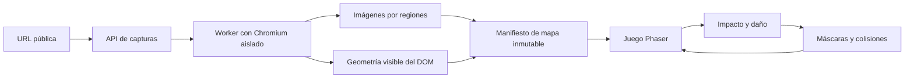

# My-Destroy: investigación y plan de construcción

Fecha de consulta: 15 de octubre de 2026, hora de Colombia.

## 1. Decisión propuesta

Construir un juego de navegador en el que una URL pública se convierte en un nivel: un personaje corre, salta y dispara sobre una representación destructible de la página. Escopetas, granadas, cohetes y poderes especiales comparten un motor de daño. La web de origen permanece intacta.

Arquitectura elegida: **captura visual + geometría del DOM + destrucción por regiones**. El servicio de captura entrega imágenes y datos; el navegador del jugador ejecuta el juego. El JavaScript del sitio visitado se ejecuta únicamente dentro del navegador aislado de captura, no dentro de la aplicación del jugador.

El primer entregable será una escena local pequeña y cuidada: una página, un personaje, un arma y un impacto convincente, antes de ampliar la funcionalidad o incorporar URLs. Se priorizan composición, nitidez, animación, sonido y estados de interfaz. La visión completa incluye multijugador, materiales, poderes, reparación y repeticiones; cada fase debe conservar una versión jugable.

La dirección y los recursos preparados se detallan en `DIRECCION-ARTISTICA.md`, la lámina `art-direction.html` y `assets/README.md`. Se guardaron packs con licencias específicas y un manifiesto de procedencia; no se extrajo arte del juego de referencia.

## 2. Qué se pudo comprobar

Se leyó el texto adjunto y se inspeccionaron repositorios y documentación públicos. No se ejecutaron los juegos de referencia ni se midió su rendimiento. El acceso directo a `destroy.spritefusion.com` y a `www.spritefusion.com` devolvió `Tunnel connection failed: 403 Forbidden` en la red del entorno; no se inspeccionaron sus bundles ni su tráfico. Por ello, el motor y el backend exactos del original quedan sin confirmar.

| Referencia | Evidencia revisada | Conclusión útil |
| --- | --- | --- |
| Capturas aportadas del original | Personaje, arsenal, barra porcentual, agujeros y fragmentos; botones para compartir y multijugador | Definen la experiencia visual buscada; no revelan el stack |
| `ychisbest/destroy-any-website` | README, `package.json`, `server.js` y `public/game.js`, commit `1c0efd5d1eab8f109bd879053e6f19ca7c876374` | El clon usa Node sin dependencias npm, proxy HTML, iframe del mismo origen, plataformas del DOM y Canvas; no usa Phaser |
| `ParthJadhav/RageLayer` | README, arquitectura, compatibilidad y licencia, commit `4e27d359ca4b9449790a66cc489a3dbf886cedf3` | Demuestra captura del DOM, máscaras, fragmentación y efectos; es una biblioteca de destrucción de la página anfitriona, no un importador universal de URLs |
| Phaser | README oficial, guía de migración y metadatos npm | La versión publicada consultada es `4.2.1`; deben usarse las APIs de v4 y evitar mezclar ejemplos de máscaras y shaders de v3 |
| Playwright | Documentación oficial de screenshots y Docker | Permite capturas de página y de elementos; el despliegue del navegador requiere aislamiento real |
| MDN y html2canvas | Mismo origen, Canvas/CORS y FAQ | Un iframe externo y html2canvas no proporcionan acceso general al DOM ni a los píxeles de cualquier web |

Correcciones al texto adjunto:

- Phaser es una elección para My-Destroy; no está demostrado que sea el motor del original.
- Un proxy que elimina `<script>` pierde contenido de muchas SPA. Sanitizar HTML con expresiones regulares tampoco es una base suficiente para alojar contenido externo dentro del origen de la aplicación.
- Una captura sola permite hacer agujeros, pero necesita geometría adicional para plataformas y fragmentos asociados a elementos.
- RageLayer es una referencia aprovechable para efectos. Su propia documentación mantiene las restricciones CORS y reconoce captura de mejor esfuerzo en Safari y Firefox.
- El clon declara `MIT` en `package.json`, pero no se encontró un archivo de licencia independiente. Antes de reutilizar código o assets hay que aclarar su procedencia y avisos. RageLayer sí incluye una licencia MIT explícita y avisos de terceros.

## 3. Stack elegido

| Parte | Tecnología | Motivo |
| --- | --- | --- |
| Interfaz | React + TypeScript + Vite | URL, carga, errores, inventario y ajustes fuera del bucle de juego |
| Juego | Phaser `4.2.1`, fijado inicialmente | Escenas, cámara, input, sprites, partículas y render WebGL |
| Daño y colisiones del terreno | Módulo TypeScript propio con máscaras por regiones | Una misma fuente de daño actualiza la apariencia y las plataformas |
| Personaje | Controlador cinemático con paso fijo | Control preciso sobre plataformas que desaparecen |
| Fragmentos | Balística sencilla al principio; Matter.js si se requieren apilamiento y contactos | Mantiene acotada la simulación; no convierte cada píxel en un cuerpo |
| API | Node.js 24 LTS + TypeScript + Fastify | Validación, estados de captura y entrega de mapas |
| Captura | Playwright + Chromium, worker separado | Renderizar webs con JavaScript y extraer su geometría |
| Audio | Web Audio API | Mezcla, volumen y sonidos activados después de una interacción |
| Pruebas | Vitest + Playwright | Daño y física verificables, integración y recorrido de usuario |
| Almacenamiento | Archivos locales y manifiestos para desarrollo | Evita una base de datos antes de necesitar cuentas o historial |
| Evolución | Almacenamiento compatible con S3; Colyseus/WebSocket para salas | Añadir cuando los mapas y el protocolo estén estabilizados |

El juego no necesita una API de IA, Unity ni un backend GPU. La captura de la página y el motor de destrucción se implementan con tecnologías web.

## 4. Flujo de una URL a un mapa



### Captura

1. Normalizar una URL HTTP/HTTPS y crear un trabajo con estado `queued`, `capturing`, `ready` o `failed`.
2. Abrir un contexto nuevo de Chromium, sin sesiones personales ni credenciales de la aplicación. Para una primera prueba: viewport 1440 × 900 y DPR 1, como parámetros del mapa.
3. Esperar `DOMContentLoaded`, fuentes y un intervalo acotado de estabilidad visual. `networkidle` no será el único criterio: las webs pueden mantener conexiones permanentes.
4. Hacer desplazamiento controlado para cargar recursos diferidos, con presupuesto de tiempo y altura. Desactivar animaciones y congelar el contenido seleccionado antes de medir y capturar.
5. Extraer rectángulos visibles de imágenes, botones, bloques y líneas de texto mediante `getBoundingClientRect()` y `Range.getClientRects()`. No envolver todas las palabras en nuevos elementos, porque puede alterar el diseño.
6. Filtrar elementos ocultos, contenedores gigantes, duplicados y zonas recortadas. Resolver superposición y validar las plataformas con fixtures; el rectángulo del DOM por sí solo no garantiza una superficie visible.
7. Capturar en regiones con un origen común. Probar explícitamente `fixed`, `sticky`, scroll y costuras; si es necesario, normalizar su posición en la copia de captura y documentar esa aproximación.
8. Entregar únicamente imágenes controladas y JSON validado. Guardar viewport, coordenadas en píxeles CSS, versión de formato y hash del mapa. La anchura del mapa no cambia con el dispositivo del jugador; se adapta la cámara.

No se reconstruirán píxeles del HTML en el cliente para el camino principal. El backend sirve las capturas desde el mismo origen o con CORS explícito, evitando un Canvas contaminado.

Los iframes externos, Canvas/WebGL, vídeos y Shadow DOM pueden aparecer en la imagen sin aportar geometría semántica completa. En esas áreas se permite destrucción visual y se usan plataformas aproximadas, o se comunica que el mapa tiene interacción reducida.

### Contrato inicial del mapa

```ts
type LevelManifest = {
  schemaVersion: 1;
  levelId: string;
  contentHash: string;
  viewport: { width: number; height: number; deviceScaleFactor: number };
  world: { width: number; height: number };
  tiles: Array<{
    id: string;
    imageUrl: string;
    x: number; y: number; width: number; height: number;
  }>;
  regions: Array<{
    id: string;
    kind: 'text' | 'image' | 'block';
    x: number; y: number; width: number; height: number;
    platform: boolean;
  }>;
  warnings: string[];
};
```

El hash representa las imágenes y datos congelados, no solamente la URL. Dos capturas de una misma URL pueden producir mapas distintos.

### API prevista

- `POST /api/captures`: URL y perfil admitido; devuelve un identificador de trabajo.
- `GET /api/captures/:id`: estado, error explicable o identificador de mapa.
- `GET /api/levels/:id`: manifiesto inmutable.
- `GET /api/levels/:id/tiles/:tile`: imágenes propias de la captura.

Durante desarrollo se emplean perfiles y fixtures locales. No se ofrece un proxy abierto de recursos arbitrarios.

## 5. Motor de destrucción

### Un impacto actualiza cuatro cosas

1. **Superficie visual:** la máscara hace transparente el área dañada y deja ver el fondo.
2. **Colisiones:** las plataformas pierden el tramo alcanzado; el personaje puede atravesar el hueco.
3. **Fragmentos:** una cantidad acotada de recortes sale despedida con velocidad, giro y duración.
4. **Estadísticas:** se cuenta únicamente el área nueva destruida.

Usar regiones de 512 × 512 como punto de partida, ajustables tras medir. Cada región conserva su imagen original y su máscara de supervivencia. Mantener una rejilla de daño en CPU, inicialmente de 4 píxeles CSS por celda, y derivar de ella las máscaras visuales. No leer toda la textura de la GPU en cada disparo.

Las plataformas proceden de la geometría seleccionada, no del fondo blanco de la captura. La rejilla de daño recorta sus intervalos de soporte. Las actualizaciones afectan únicamente a las regiones y plataformas tocadas; no recorren todo el documento por impacto.

El daño se expresa mediante eventos versionados con coordenadas del mundo:

```ts
type DamageEvent = {
  version: 1;
  eventId: string;
  tick: number;
  shape: 'circle' | 'segment';
  x: number; y: number;
  endX?: number; endY?: number;
  radius: number;
  power: number;
  seed: number;
};
```

Los valores se validan y las coordenadas de la rejilla se cuantizan. El mismo evento puede producir partículas distintas según la calidad gráfica, conservando igual daño lógico.

El porcentaje usa la unión inicial de celdas de las regiones destructibles seleccionadas. El fondo no interactivo y las superposiciones no se suman otra vez. Cada celda cruza de intacta a destruida una sola vez. El porcentaje debe llamarse «área destructible destruida» y mantenerse entre 0 y 100; la versión inicial será una medida de área aproximada, no un conteo exacto de píxeles de letras.

### Armas como datos

| Arma | Mecánica | Prueba distintiva |
| --- | --- | --- |
| Pistola | Impacto puntual o raycast | Abre un hueco pequeño donde apunta |
| Escopeta | Varios rayos con dispersión sembrada | Los impactos forman un abanico reproducible |
| Lanzagranadas | Trayectoria balística, rebotes y espoleta | Explota al terminar el temporizador, incluso tras cambiar de arma |
| Lanzacohetes | Proyectil y daño radial al colisionar | Elimina soporte y empuja fragmentos |
| Láser | Segmento continuo o pulso | Recorta un tramo largo sin saltarse regiones |
| Lanzallamas | Calor acumulado y propagación acotada | El fuego persiste y consume combustible por pasos |
| Agujero negro | Atracción, órbita y absorción | Atrae fragmentos sin provocar crecimiento ilimitado de entidades |
| Cañón orbital | Aviso, haz y onda expansiva | Daño por fases y efectos que se adaptan a la calidad |
| Reparador | Restauración desde la imagen y máscara iniciales | Recupera apariencia, plataformas y porcentaje |

No se programa un motor diferente por arma. Cadencia, dispersión, radio, retroceso, proyectil y efecto son configuración sobre las mismas operaciones de daño.

## 6. Experiencia y ambición

**Primera versión:** pantalla de URL y demo inmediata, personaje con movimiento y salto, cámara vertical, pistola, escopeta, lanzagranadas, progreso, pausa, reinicio y ajustes de sonido/efectos. Incluir un fondo pixel art que aparece al romper la página.

**Ampliación del arsenal:** cohetes, láser, fuego, electricidad, hielo que vuelve frágiles las superficies, ácido, agujero negro y hechizos como el de la segunda captura. Clasificar madera, papel, cristal o metal será primero una asignación de diseño; no se afirmará que el DOM revela materiales físicos reales.

**Modos:** sandbox con munición infinita, contrarreloj, retos por arma, caída vertical, cooperativo y competición. Añadir una herramienta de reparación, historial de acciones y repeticiones basadas en un mapa congelado y eventos.

**Identidad propia:** animación original del personaje, combinaciones entre armas, editor de reglas, fondos desbloqueables y exportación de clips cortos. La captura de vídeo dependerá de los codecs y APIs disponibles y tendrá una alternativa de descarga de imagen.

**Móvil y accesibilidad:** controles táctiles en una fase explícita; teclado configurable, volumen independiente, texto legible, reducción de destellos y vibración de cámara desactivable. La estética pixel art del juego no debe hacer ilegible la página capturada.

«Sin límites» puede ser un ajuste de munición, poderes y reglas del sandbox. La memoria, el coste de captura y la compatibilidad de webs necesitan presupuestos técnicos para que el juego siga respondiendo.

## 7. Fases con criterios de salida

| Fase | Entrega | Se considera terminada cuando… |
| --- | --- | --- |
| 0. Base reproducible | Workspace npm, app Vite, módulos TS, mapa fixture y scripts | Una instalación con lockfile levanta la demo sin cuentas ni servicios externos |
| 1. Destrucción local | Captura fixture, máscaras, pistola, escopeta, reinicio | Hay huecos persistentes, daño repetido no duplica progreso y reiniciar restaura el estado |
| 2. Personaje y física | Movimiento, salto, cámara y plataformas destructibles | El personaje cae por un tramo destruido y conserva control en páginas largas |
| 3. URL real | API, worker Chromium, manifiestos y errores | Un corpus público definido se convierte en niveles; cada fallo informa el motivo |
| 4. Arsenal y presentación | Granadas, cohetes, fragmentos, audio, fondo y hechizos | Cada arma ejerce su mecánica propia, los temporizadores sobreviven al cambio de arma y el juego sigue fluido |
| 5. Robustez | Caché, carga por regiones, Safari/Firefox, perfiles y observabilidad | Pasa el corpus acordado, libera recursos al cambiar de mapa y respeta el presupuesto medido |
| 6. Multijugador | Salas, servidor de estado, reconexión y mapas compartidos | Dos jugadores terminan con el mismo estado de destrucción y una reconexión restaura ese estado |
| 7. Expansión | Materiales, retos, reparación, replays y móvil | Cada modo tiene pruebas propias y no rompe el núcleo single-player |

Las fases 0–4 componen el primer producto jugable. No esperar a terminar multijugador o todos los efectos para probarlo. La carga por URL y la calidad de las plataformas son los mayores riesgos del plan; validarlas antes de invertir en contenido adicional.

Como referencia de planificación, una demo local puede ser un bloque corto de trabajo; un producto público robusto requiere varias iteraciones. No se promete un plazo sin medir antes captura, colisiones y alcance gráfico.

## 8. Pruebas que demuestran funcionamiento

No se han ejecutado estas pruebas: son criterios de aceptación para la implementación futura.

- **Daño:** impactos repetidos sobre el mismo hueco no aumentan el porcentaje; un impacto en una esquina actualiza todas las regiones afectadas; el reinicio devuelve la máscara inicial.
- **Colisiones:** destruir el soporte provoca caída; plataformas superpuestas no crean suelos invisibles; disparos rápidos no atraviesan un obstáculo por saltarse pasos de simulación.
- **Captura:** fixtures para artículo, tarjetas, imágenes entre dominios, SPA, página larga, contenido `fixed`/`sticky`, iframe y recursos que fallan. Captura y geometría deben coincidir después del scroll.
- **Integración:** trabajo de captura real → manifiesto → imágenes → mapa jugable. Un mock de imágenes no sustituye esta prueba.
- **Navegadores:** Chromium y WebKit automatizados, Firefox al estabilizar el núcleo y comprobación manual en Safari real, porque WebKit de Playwright no equivale por completo a Safari.
- **Rendimiento:** definir equipo y escena antes de publicar cifras. Objetivo inicial, no resultado medido: aproximadamente 60 FPS en portátil con gráfica integrada, con perfil de 30 FPS para equipos modestos. Registrar tiempos de frame p50/p95, entidades, regiones residentes y crecimiento de memoria en sesiones largas.
- **Seguridad de captura:** URL inválida, redirección a dirección privada y subrecurso privado se rechazan; una web lenta termina por timeout y no deja un proceso huérfano.
- **Multijugador posterior:** mismo hash de mapa, orden de eventos, checksum de máscara y recuperación tras perder conexión.

Fijar capturas y semillas para las pruebas. No depender de que una web pública cambie o siga disponible para comprobar el daño del juego.

## 9. Rendimiento y operación

- Simulación con paso fijo; interpolación del render y acumulador acotado para recuperarse después de pausar una pestaña.
- Cargar regiones visibles y un margen; expulsar las lejanas de GPU, conservando datos compactos de daño y una fuente para reconstruirlas.
- Agrupar partículas y reutilizar entidades. Acotar fragmentos, apagar cuerpos en reposo y retirar los que ya no aportan al juego.
- Dibujar sprites y efectos pixel art a menor resolución si conviene, con escalado nearest-neighbor; conservar la página a resolución legible. Esa es una decisión de My-Destroy, no una afirmación verificada sobre el original.
- Separar eventos de daño, renderizado y efectos para que reducir la calidad no cambie las reglas.
- Comenzar con un worker de captura y concurrencia conservadora, por ejemplo dos trabajos, y ajustar tras medir RAM y tiempos. Hacer la cola y los límites observables.
- Cachear por URL normalizada, viewport, perfil y versión del capturador. Cada resultado tiene su propio hash; la URL por sí sola no identifica un mapa reproducible.
- Medir segundos de navegador por captura, tasa de acierto de caché y transferencia de imágenes antes de presupuestar el hosting. Los efectos se ejecutan en el cliente; la captura será normalmente el coste variable principal.

Frontend estático y API/worker pueden desplegarse por separado. El worker necesita un contenedor o VM capaz de ejecutar Chromium; no debe suponerse que una función serverless pequeña o un Worker de borde ejecutará Chromium localmente sin un servicio adicional. En producción, las capturas compartidas necesitan almacenamiento persistente.

## 10. Compatibilidad y aislamiento de URLs

La promesa de producto será «convierte muchas webs públicas en escenarios», con demo y subida de imagen como alternativas. Una imagen subida permite destrucción visual; las plataformas serán automáticas aproximadas o editadas, al no existir DOM.

Logins, CAPTCHAs, contenido privado, bloqueos de automatización, páginas enormes y rendering especial pueden impedir o degradar una captura. No se resolverán intentando omitir autenticación. Un modo de extensión para capturar la pestaña que el propio usuario ve puede evaluarse después, con permisos y tratamiento de datos propios.

Al aceptar URLs arbitrarias, el capturador debe tener salida restringida a destinos públicos, validar redirecciones y subrecursos, cubrir IPv4/IPv6 y evitar DNS rebinding. La barrera de red debe aplicar a las conexiones reales; una validación inicial del texto de la URL no basta. El navegador se ejecuta sin privilegios, con sandbox habilitado y límites de recursos, sin secretos ni acceso a redes internas de la aplicación.

En esta máquina se comprobó el acceso a fuentes en GitHub y npm; el dominio del original está bloqueado. Para capturar sitios desde este mismo entorno se necesitará permitir sus dominios y los de sus recursos en la política de red, o usar un worker de captura externo con su política correspondiente. El modo demo no depende de esa configuración.

## 11. Multijugador: decisión posterior

Todos descargan exactamente el mismo manifiesto e imágenes; no recapturan la URL por separado. El servidor ordena impactos y determina el daño. La animación local puede anticiparse y reconciliarse con la respuesta.

Las semillas reproducen dispersión y efectos, pero no garantizan determinismo de toda la física entre navegadores. Para terreno se usarán operaciones enteras versionadas y checksums; el servidor enviará deltas o snapshots de regiones. Los fragmentos cosméticos podrán diferir. Se guardan checkpoints para entrar tarde o reconectar sin repetir toda la partida.

Colyseus o una biblioteca WebSocket mantenida son opciones; no hace falta implementar manualmente el protocolo WebSocket del clon.

## 12. Organización prevista

```text
My-Destroy/
  apps/web/              # React, HUD, escenas Phaser
  apps/api/              # Trabajos, niveles y entrega de recursos
  apps/capture-worker/   # Playwright y extracción, despliegue aislado
  packages/core/         # Daño, rejillas, intervalos y estadísticas
  packages/contracts/    # Esquemas de mapa, trabajos y eventos
  fixtures/              # Mapas locales y páginas de captura controladas
  tests/e2e/             # Recorridos completos
  docs/                  # Decisiones y resultados medidos
```

Los scripts previstos serán `dev`, `dev:demo`, `build`, `typecheck`, `test` y `test:e2e`. Son una propuesta; el repositorio todavía no contiene la aplicación ni dependencias instaladas para ella.

## 13. Orden de construcción inmediato

El objetivo es construir My-Destroy con acabado profesional. La primera entrega integra la dirección artística y el núcleo mínimo de destrucción en una escena pequeña. A continuación se completa personaje y colisiones, y después se conectan URLs reales. Las decisiones de producto y los criterios de aceptación se mantienen en este plan con independencia de las herramientas de desarrollo utilizadas.

Ver `IMPLEMENTACION.md` para las tareas concretas, sus dependencias y la definición de terminado del primer producto jugable.

## 14. Fuentes y alcance de la investigación

- Original aportado: <https://destroy.spritefusion.com/> — acceso bloqueado; capturas del usuario disponibles.
- Artículo citado en el adjunto: <https://www.spritefusion.com/blog/pixel-art-rendering-trick-for-a-90s-look> — no se pudo verificar su contenido desde este entorno.
- Clon, fuente inspeccionada: <https://github.com/ychisbest/destroy-any-website/tree/1c0efd5d1eab8f109bd879053e6f19ca7c876374>.
- RageLayer, fuente inspeccionada: <https://github.com/ParthJadhav/RageLayer/tree/4e27d359ca4b9449790a66cc489a3dbf886cedf3>.
- Licencia explícita de RageLayer: <https://github.com/ParthJadhav/RageLayer/blob/4e27d359ca4b9449790a66cc489a3dbf886cedf3/LICENSE>.
- Phaser: <https://github.com/phaserjs/phaser>, metadatos <https://registry.npmjs.org/phaser/latest> y paquete fijado <https://github.com/phaserjs/phaser/blob/v4.2.1/package.json>.
- Migración Phaser 4: <https://github.com/phaserjs/phaser/blob/master/changelog/v4/4.0/MIGRATION-GUIDE.md>.
- Playwright, capturas: <https://github.com/microsoft/playwright/blob/main/docs/src/screenshots.md>.
- Playwright, navegador en Docker: <https://github.com/microsoft/playwright/blob/main/docs/src/docker.md>.
- MDN, mismo origen: <https://developer.mozilla.org/en-US/docs/Web/Security/Defenses/Same-origin_policy>; contenido leído en su [repositorio oficial](https://github.com/mdn/content/blob/main/files/en-us/web/security/defenses/same-origin_policy/index.md).
- MDN, Canvas/CORS: <https://developer.mozilla.org/en-US/docs/Web/HTML/How_to/CORS_enabled_image>; contenido leído en su [repositorio oficial](https://github.com/mdn/content/blob/main/files/en-us/web/html/how_to/cors_enabled_image/index.md).
- html2canvas, límites: <https://github.com/niklasvh/html2canvas/blob/master/docs/faq.md>.

Este entregable es una investigación y un plan. No se ha implementado, publicado ni validado una aplicación My-Destroy. No se cambiaron scripts de instalación o arranque del entorno para una aplicación todavía inexistente.
