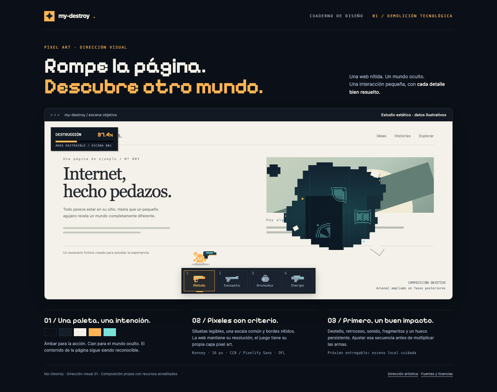

# My-Destroy

Juego web en desarrollo: convertir una URL en un escenario que puedes recorrer y destruir con armas y poderes. La destrucción ocurre sobre una representación de la página; el sitio original permanece intacto.

## Propuesta visual

Esta imagen presenta la dirección visual inicial. Es una composición estática; todavía no es una demo jugable.



[Abrir la imagen a tamaño completo](docs/art-direction-preview.png)

## Documentación

- [Dirección artística y primera escena](DIRECCION-ARTISTICA.md)
- [Plan de implementación por hitos](IMPLEMENTACION.md)
- [Arquitectura e investigación técnica](PLAN.md)
- [Recursos preparados, autores y licencias](assets/README.md)
- [Revisión de la lámina visual](docs/VISUAL-REVIEW.md)

La primera entrega será una escena pequeña y cuidada: una página, un personaje, un arma y un impacto convincente. Después se ampliarán movimiento, arsenal y carga de URLs reales.

## Ver la lámina en el navegador

GitHub muestra la imagen anterior, pero no ejecuta el HTML desde la vista de archivos. Para ver la composición HTML, descarga o clona el repositorio y, desde su carpeta, ejecuta:

```bash
python3 -m http.server 8000 --bind 127.0.0.1
```

Abre `art-direction.html` desde ese servidor local. La lámina usa recursos incluidos en el repositorio y no necesita dependencias npm ni claves. Este comando sirve únicamente para la lámina; la aplicación y el motor del juego aún no están implementados.

## Recursos artísticos

Se incluyen fuentes de Kenney con licencia CC0 y Pixelify Sans con licencia OFL, con sus avisos y procedencia en `assets/`. Esas licencias corresponden a los recursos identificados, no establecen una licencia general para todo el proyecto.
